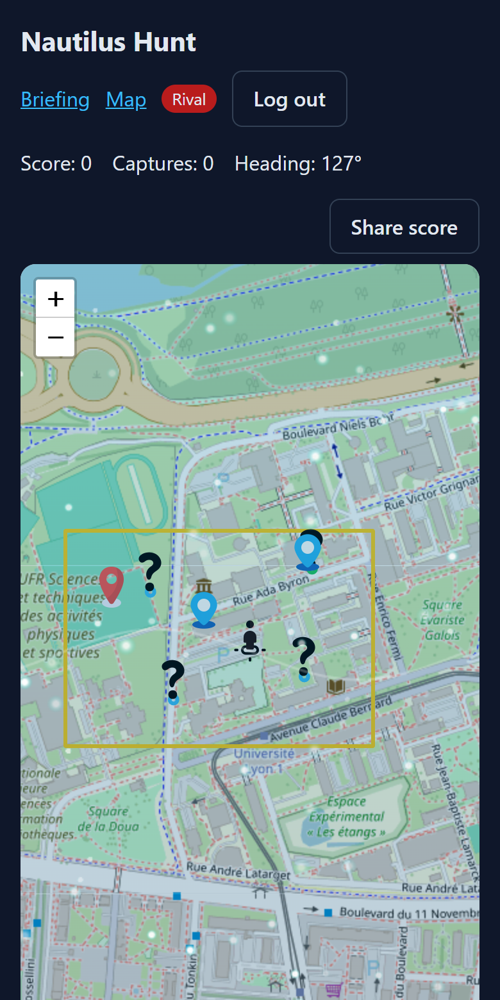
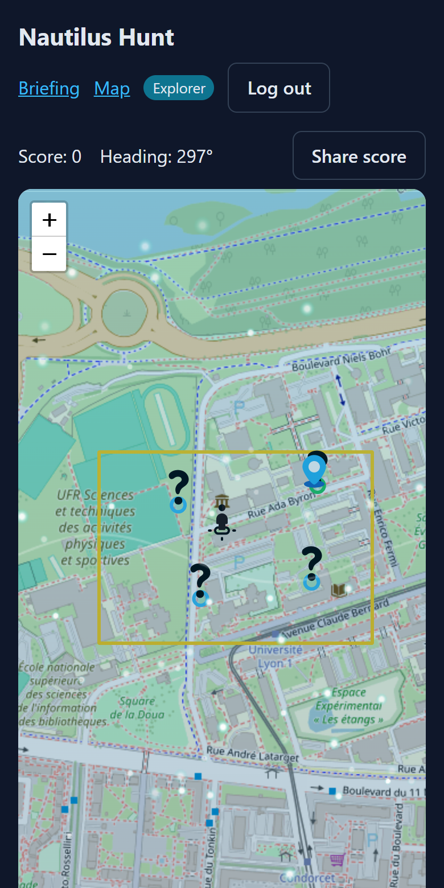
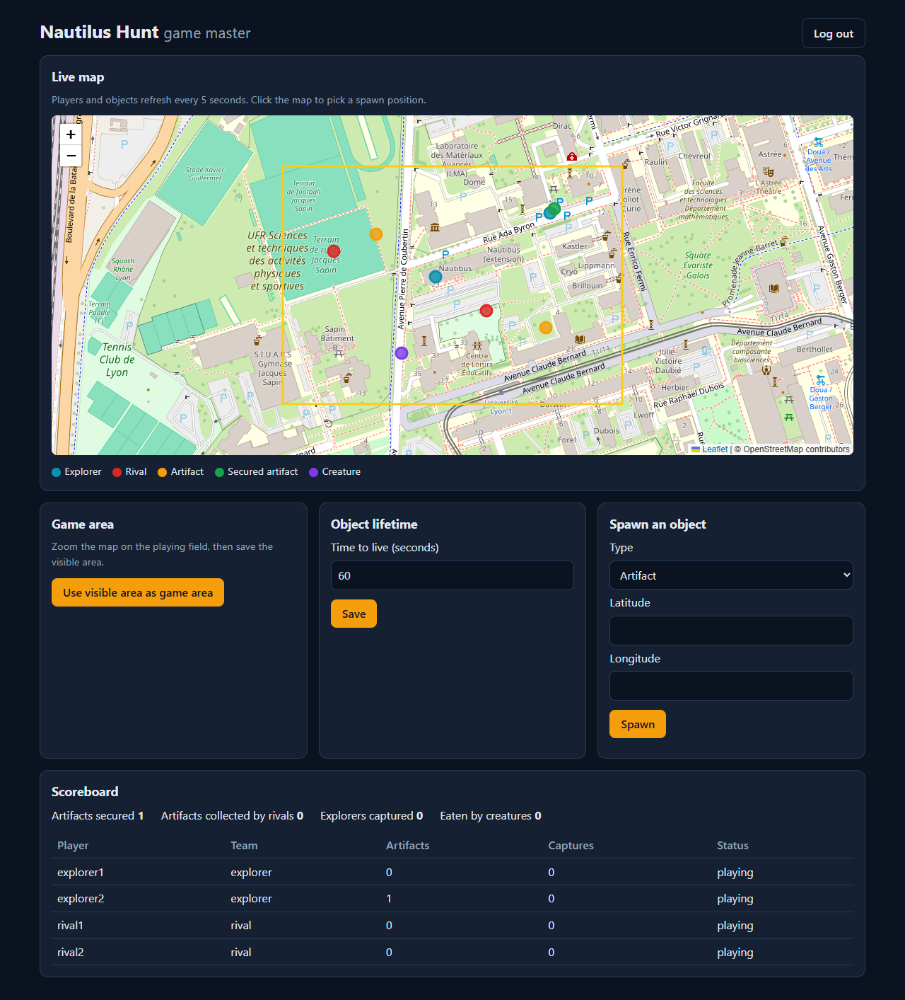
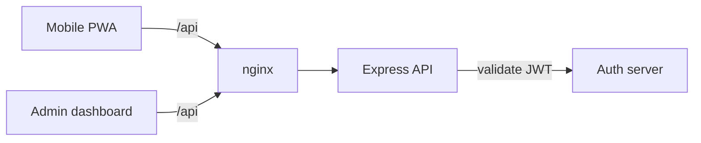

# Nautilus Hunt: location-based multiplayer game (Vue 3 PWA + Express)

A game played outdoors on a real map. Players move with their phone's GPS, and a game master
spawns objects around them.

- **Explorers** see objects only as blurred areas. They secure artifacts by getting within 10 m.
- **Rivals** see exact positions and every explorer. They collect artifacts that are not secured
  yet, and capture explorers who come within 5 m.
- Some objects are **sea creatures**. Nobody knows which until they get close, and walking
  within 5 m of one ends the game.

<p>
  
  
</p>



## Stack

| Part | Tech |
|---|---|
| Mobile app (`mobile/`) | Vue 3, TypeScript, Pinia, Vue Router, Leaflet, Vite, PWA (Workbox) |
| Game master dashboard (`admin/`) | TypeScript, Webpack, Leaflet, no framework |
| API (`api/`) | Node.js, Express 5, Winston, Jasmine + Supertest |
| Auth (`auth-mock/`) | JWT, Express (local stand-in for the university's auth server) |
| Infra (`infra/`) | Docker Compose, nginx reverse proxy, GitHub Actions, PM2 for the VM deployment |

## Run it

Requires Docker.

```bash
docker compose up --build
```

- Players: http://localhost:8080
- Game master: http://localhost:8080/admin/

Demo accounts (password = login): `admin`, `explorer1`, `explorer2`, `rival1`, `rival2`.

To try a game on one computer:
1. Sign in as `admin` on the dashboard, save a game area and spawn a few objects.
2. Open the player app as `explorer1` in one window and as `rival1` in a private window.
3. Click the map to move a player. Without GPS, this is how you walk around.

### Without Docker

```bash
cd auth-mock && npm install && npm start      # port 8080
cd api       && npm install && npm run dev    # port 3376
cd mobile    && npm install && npm run dev    # http://localhost:5173
cd admin     && npm install && npm run dev    # http://localhost:8081
```

## How it works



- The API keeps the game state in memory: a game lasts minutes and does not need a database.
- **The server decides what each player can see.** Explorers never receive rival positions or object
  types. Their object positions are offset by up to 10 m, and the offset is drawn once per
  object so that averaging several requests does not reveal the real spot.
- The server also checks every distance (haversine formula). The client only uses distances to avoid
  sending pointless requests.
- Game rules live in plain functions (`api/src/game/game.js`) with no Express code. Routes are
  thin wrappers around them, and the token validator is injected, so tests run without an auth server.

### Browser APIs used by the mobile app

Geolocation (`watchPosition`) and heading computation, Vibration, Notifications, Screen Wake Lock,
Web Share (with a file download as fallback), Service Worker with offline map tiles, and a Web Worker
drawing an animated layer on an `OffscreenCanvas`.

## API

| Method | Route | Who | Description |
|---|---|---|---|
| POST | `/auth/login` | anyone | Returns a JWT |
| POST | `/game/position` | player | Update own position; a nearby creature eliminates the player |
| GET | `/game/resources` | all | Players and objects visible to the caller |
| POST | `/game/objects/:id/treat` | player | Secure (explorer) or collect (rival) an object |
| POST | `/game/explorers/:id/capture` | rival | Capture an explorer within 5 m |
| GET | `/game/zrr` | all | Game area |
| POST | `/admin/zrr` | admin | Set the game area |
| POST | `/admin/ttl` | admin | Set the lifetime of new objects |
| POST | `/admin/objects` | admin | Spawn an artifact or a creature |
| GET | `/admin/stats` | admin | Scoreboard |

## Tests and CI

```bash
cd api && npm test
```

GitHub Actions lints and tests the API, then type-checks and builds both front-ends and the
Docker images on every push. A second workflow deploys to a VM over SSH: static files go to
nginx and the API runs under PM2 (`infra/nginx/production.conf`, `api/ecosystem.config.cjs`).

## Performance

The mobile client was profiled with Lighthouse and User Timing marks. Updating map markers in
place, moving the animation into a Web Worker and loading fewer tiles took the Lighthouse score
from 66 to 75 and halved Total Blocking Time. Details: [docs/performance.md](docs/performance.md).

## Context

Started as a two-person project for the "Advanced Web & Mobile Web" course of my Master's degree
in Computer Science (Université Lyon 1, 2026). It was originally deployed on a university VM with
GitLab CI. I then reworked this version on my own: merged the explorer and rival apps into one
role-based PWA, moved the game rules into tested functions, added the dashboard login and
scoreboard, the Docker setup and the GitHub Actions workflows.
