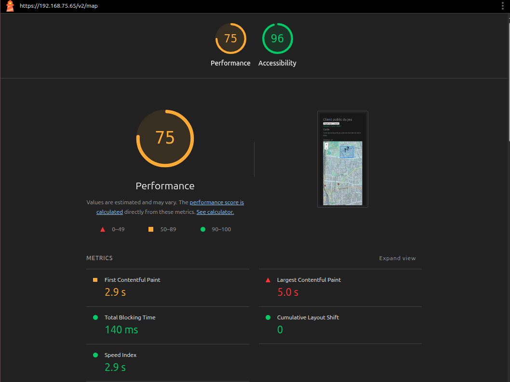

# Performance work on the mobile client

The mobile app was profiled with Lighthouse (mobile preset) and with custom
[User Timing](https://developer.mozilla.org/en-US/docs/Web/API/Performance_API/User_timing)
marks around the main refresh loop (`fetchResources` in `mobile/src/stores/game.ts`).
Measurements were taken on the deployed version (nginx, HTTPS, production build).

## What was measured

Every 10 seconds the client fetches the game state and redraws the map. Three measures cover that loop:

| Measure | Covers |
|---|---|
| `resources-fetch` | network round trip to `/api/game/resources` |
| `resources-processing` | parsing and splitting players / objects in the store |
| map redraw | marker updates in Leaflet, batched with `requestAnimationFrame` |

## Changes and their effect

| Step | Change | Result |
|---|---|---|
| 1 | Baseline: markers cleared and recreated on every refresh | processing 3–6 ms |
| 2 | Markers updated in place (keyed by id) and redraws batched in `requestAnimationFrame` | processing 2–4 ms |
| 3 | Underwater animation moved to a Web Worker with `OffscreenCanvas` | main thread free for Leaflet, processing 2–3 ms |
| 4 | Lower initial zoom (fewer tiles on first paint), refresh every 10 s instead of 5 s | half the requests and redraws |

Added after these measurements (not benchmarked yet): the map page is loaded lazily
(`import()` in the router), so the login and briefing screens no longer download Leaflet.

## Lighthouse on the deployed app

| Metric | Before | After |
|---|---|---|
| Performance score | 66 | **75** |
| Accessibility score | 92 | **96** |
| First Contentful Paint | 2.8 s | 2.9 s |
| Largest Contentful Paint | 6.3 s | **5.0 s** |
| Total Blocking Time | 300 ms | **140 ms** |
| Speed Index | 3.5 s | **2.9 s** |

## Takeaways

- The client-side processing was never the bottleneck (a few milliseconds). Most of the
  load time goes to Leaflet, the JavaScript bundle and the OpenStreetMap tiles.
- Together, these changes halved the Total Blocking Time (300 → 140 ms), which is what makes
  the map feel smooth while dragging. Running the animation in a worker matters here: it adds a
  continuous 60 fps workload that would otherwise compete with Leaflet on the main thread.
- LCP is still the weak point: it is the map itself, which depends on third-party tiles.
  Next steps would be a static placeholder for the first paint and preconnecting to the tile server.
